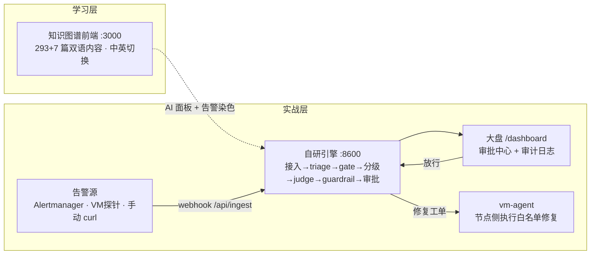

# AIOps Roadmap · 智能运维学习 + 实战双系统

> 一套「**学**」与「**练**」解耦的 AIOps 项目：前端是用知识图谱把 SRE/DevOps 体系讲清楚的学习网站，后端是一套自研的告警研判引擎，再配一个跑在虚拟机里的故障探针 + 修复 agent，让你能真刀真枪看到「告警 → 诊断 → 审批 → 修复」的完整闭环。

📚 **配套博客系列（6 篇，含架构/前端/引擎/编排/实验详解）**：
https://hyrx-tg.github.io/2026/10/29/f1a0b101/

---

## 它是什么

| 层 | 端口 | 是什么 | 角色 |
|----|------|--------|------|
| **知识图谱前端** | `:3000` | Next.js 16 + React 19 + Tailwind v4 的静态网站 | **学习层**：13 个主题区、300 个节点（293 篇社区内容 + 7 篇自研 AIOps），中英双语、深浅色切换 |
| **AIOps 研判引擎** | `:8600` | FastAPI 自研引擎 | **实战层**：标准 Alertmanager webhook 接入 → 去重 → 门控 → 分级(P0–P3) → 研判(RCA) → 护栏 → dry-run 计划 → 审批中心 → 审计 |
| **vm-agent** | 虚拟机内 | 纯 stdlib 的探针 + 修复 agent | **执行层**：探针采样故障上报后端；agent 拉取审批通过的修复工单，按白名单执行 |

两个系统**解耦、各自可独立运行**：3000 不依赖 8600（AI 面板在无后端时走 mock），8600 自带 `/dashboard` 也能独立跑。它们只通过「AI 面板 + 告警染色」弱耦合。

> **Fork 说明**：前端知识图谱源自 [MansoorMajeed/infra-roadmap](https://github.com/MansoorMajeed/infra-roadmap)（已获许可的公开路线图），本仓库在其基础上做了大量二次开发：**全量中文双语化（293 篇）+ 自研 AIOps 引擎 + vm-agent + Dify 编排工作流 + VM 故障注入实验**。

---

## 架构



---

## 目录结构

```
aiops-roadmap/
├── content/                 # 知识图谱内容（293 篇社区 + 7 篇自研 AIOps，frontmatter + 中英分块）
│   ├── _zones.yaml          # 分区与激活开关
│   ├── aiops/               # 自研 AIOps 区（7 篇，含 Dify+StackStorm 编排篇）
│   └── <zone>/...           # 其他 12 个主题区
├── src/                     # Next.js 16 前端（App Router + TS + Tailwind v4）
│   ├── app/  lib/  components/
├── backend/                 # FastAPI 自研引擎
│   └── app/
│       ├── server.py        # 入口：uvicorn app.server:app --port 8600
│       ├── ingest.py        # 告警归一化（Alertmanager webhook 格式）
│       ├── triage.py        # 去重 + 评分
│       ├── gate.py          # 门控（丢测试/心跳/info 噪声）
│       ├── judge.py         # 研判 RCA（规则兜底 + DeepSeek）
│       └── pipeline_research.py  # dry-run 计划 + 审批流
├── vm-agent/                # 虚拟机侧：探针 agent.py + 修复 agent + 模拟支付 API
├── alert-diagnosis-workflow.yml  # 可导入 Dify 的告警诊断工作流 DSL 骨架
├── vm_probe.py              # 独立故障探针（与 vm-agent 互补，纯 stdlib）
├── VM-FAULT-LAB.md          # 6 个真机故障注入实验手册
├── docker-compose.yml       # 全栈一键起（后端 + 前端）
└── compose.yml              # ⚠️ 原作者遗留，仅前端、镜像指向第三方，勿用于本仓库部署
```

---

## 快速开始

### 方式一：Docker 全栈（推荐）

```bash
# 在项目根目录
docker compose -f docker-compose.yml up --build
# 前端  → http://localhost:3000
# 后端  → http://localhost:8600/dashboard
# 前端设置页「后端地址」填 http://localhost:8600
```

### 方式二：分开起（开发态）

```bash
# 后端（在 backend/ 目录内）
cd backend
uvicorn app.server:app --port 8600 --reload
# 或：python -m app.server

# 前端（项目根目录）
npm install
npm run dev          # → http://localhost:3000

# vm-agent（跑在目标虚拟机内）
cd vm-agent
python3 agent.py                 # 常驻探针
python3 agent.py --selftest      # 立刻上报一条合成错误，验证连通性
```

---

## 配置

后端通过环境变量 / `.env`（已被 `.gitignore` 忽略，不会入库）配置：

| 变量 | 说明 | 默认 |
|------|------|------|
| `LLM_BASE_URL` | LLM 端点（DeepSeek 等） | 空 → 走规则兜底研判 |
| `LLM_API_KEY` | LLM API Key | 空 |
| `LLM_MODEL` | 模型名 | `deepseek-chat` |
| `AIOPS_AUTO_RESEARCH` | 自动跑 RCA 研判 | `1` |
| `AIOPS_CORS_ORIGINS` | 前端跨域白名单 | `http://localhost:3000,...` |

> 不配 LLM 也能跑：研判走 `judge.py` 的**规则兜底**（按告警特征匹配已知根因），只是没有 LLM 的语义分析。配了 DeepSeek 才是「大脑版」。

---

## 怎么喂告警

标准 **Alertmanager webhook** 格式 `POST /api/ingest`：

```bash
curl -X POST http://localhost:8600/api/ingest \
  -H 'Content-Type: application/json' \
  -d '{"alerts":[{"labels":{"alertname":"ServiceDown","severity":"critical",
       "service":"payment","env":"prod"},
       "annotations":{"description":"payment 服务无响应"}}]}'
```

触发条件：后端对 **P0(core/business + 严重) / P1(critical + 核心服务)** 自动跑 RCA。想让某条告警必进研判，用 `env=prod` + `severity=critical` + 命中的 `service`/业务关键词。

---

## 核心设计原则：平台绝不静默自动执行

告警进来后，引擎只做**诊断 + 建议 + 审批**，真正的修复动作**永远留在人手里**（或经审批后由 vm-agent 按白名单执行）。这是和「全自动自愈」最大的区别，也是安全边界：

```
告警 → 去重/门控 → 分级 → RCA 研判 → 护栏检查 → 生成 dry-run 计划
     → 【人工审批中心】放行 / 拒绝 → 审计日志 → （放行后）vm-agent 执行白名单动作
```

---

## 配套资产

- **Dify 编排工作流**：`alert-diagnosis-workflow.yml` —— 照真实 Dify 导出格式手写的告警诊断 DSL 骨架，可在 Dify 画布「导入 DSL」直接载入（start → LLM/RCA → end 三节点）。
- **VM 故障注入实验**：`VM-FAULT-LAB.md` + `vm_probe.py` —— 6 个真机实验（磁盘写满 / 杀服务 / CPU 打满 / OOM / 网络阻断 / 降噪对照），让你亲手制造故障、看大盘诊断、再亲手修复。

---

## 许可证

前端知识图谱派生自 [MansoorMajeed/infra-roadmap](https://github.com/MansoorMajeed/infra-roadmap)（请遵守其原始 LICENSE）；本仓库新增的自研引擎、中文内容、vm-agent、DSL、实验文档以 **MIT** 发布。详见 `LICENSE`。
